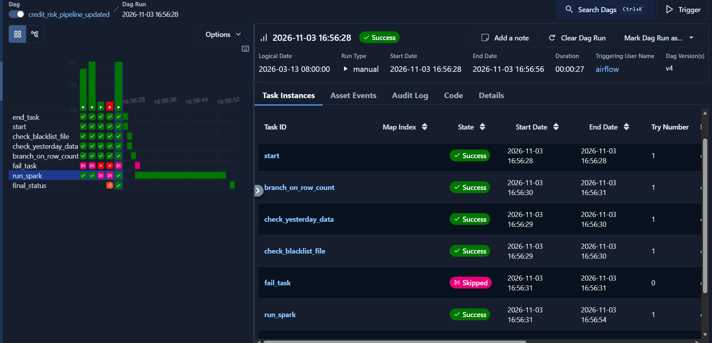
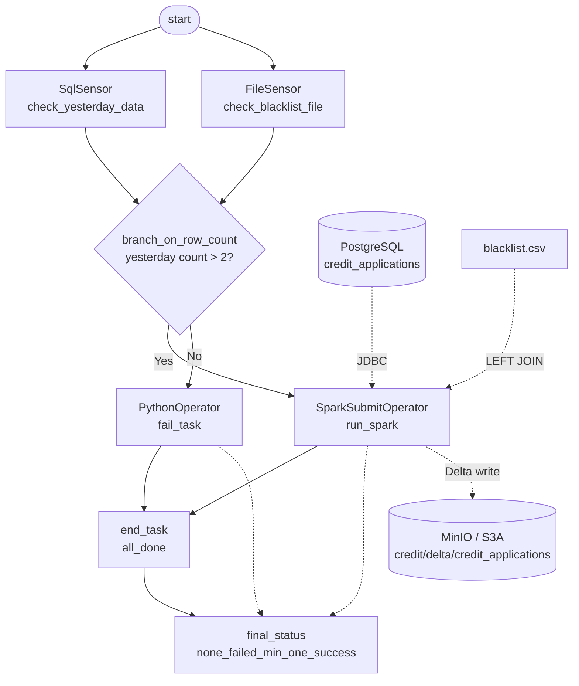
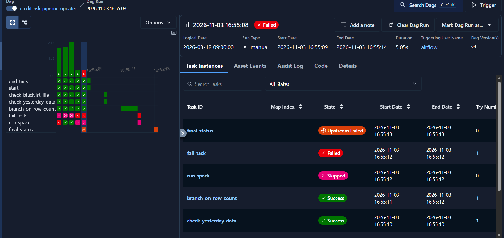
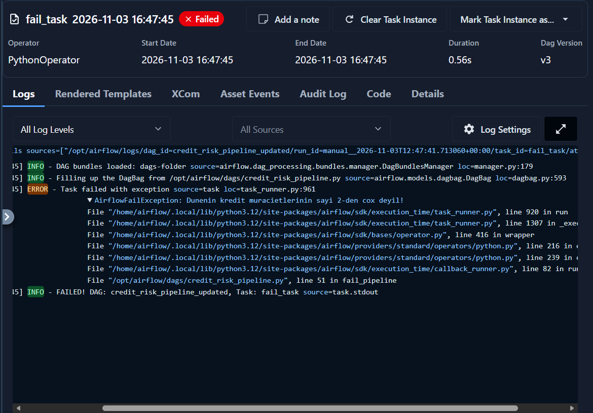
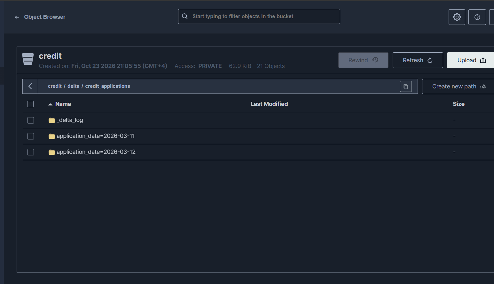

# Credit Risk Pipeline

**Apache Airflow 3 · PostgreSQL · PySpark · Delta Lake · MinIO · Docker Compose**

PostgreSQL-də saxlanılan kredit müraciətlərini CSV blacklist ilə birləşdirən, risk statusunu hesablayan və nəticələri MinIO üzərində **Delta Lake** cədvəlinə yazan end-to-end data engineering layihəsi. Airflow sensorlar, conditional branching, Spark job və failure handling prosesini idarə edir.

> **Layihənin statusu:** Lokal mühitdə həm uğurlu, həm də uğursuz branching ssenariləri **DAG v4** üzərində test olunub. Bu, tədris məqsədli kredit risk qaydalarıdır; real bank risk modeli deyil.

## Nəticələr

| Göstərici | Nəticə |
|---|---|
| PostgreSQL mənbə datası | **10** kredit müraciəti |
| `2026-03-12` tarixi üçün müraciət | **8** → Spark işləyir |
| `2026-03-11` tarixi üçün müraciət | **2** → `fail_task` işləyir |
| Risk statusları | **4 approved · 4 high_risk · 2 rejected** |
| Saxlama formatı | **Delta Lake**, `application_date` üzrə partition |
| Müsbət DAG run | **SUCCESS**, təqribən **27 saniyə** (lokal test) |
| Mənfi DAG run | **FAILED**; `end_task` yenə `SUCCESS` |



## 1. Arxitektura



**İcra ardıcıllığı:**

1. `start` iki sensoru başladır: SQL cədvəlində əvvəlki günə aid məlumat, konteynerdə blacklist CSV faylı.
2. `branch_on_row_count` əvvəlki günün müraciətlərini PostgreSQL-də sayır.
3. Say **2-dən çoxdursa**, `run_spark` PostgreSQL-i JDBC ilə oxuyur, blacklist-i LEFT JOIN edir, `risk_status` hesablayır və Delta Lake-ə yazır.
4. Say **2 və ya daha azdırsa**, `fail_task` qəsdən `AirflowFailException` yaradır və `run_spark` skip olunur.
5. `end_task` (`all_done`) hər iki nəticədən sonra işləyir. `final_status` isə əvvəlki uğursuzluqların ümumi **DAG FAILED** vəziyyətinə düzgün ötürülməsini təmin edir.

`SqlSensor` **məlumatın mövcudluğunu** yoxlayır (`COUNT(*) > 0`). **`COUNT(*) > 2`** biznes şərti isə ayrıca `BranchPythonOperator`-dadır.

## 2. Texnologiyalar

| Texnologiya | Rol |
|---|---|
| **Apache Airflow 3.1** | Orkestrasiya, sensorlar, branching, callbacks, trigger rules |
| **PostgreSQL 16** | `public.credit_applications` mənbə cədvəli |
| **Apache Spark / PySpark 3.5.3** | JDBC oxuma, CSV oxuma, LEFT JOIN, risk hesablanması |
| **Delta Lake 3.3.2** | Transaction log və partition-lu çıxış cədvəli |
| **MinIO** | Lokal S3-compatible object storage |
| **Docker Compose** | Airflow, PostgreSQL və MinIO servisləri |

Spark submit zamanı PostgreSQL JDBC, Delta Lake və Hadoop S3A paketləri əlavə olunur (`postgresql:42.7.4`, `delta-spark_2.12:3.3.2`, `hadoop-aws:3.3.4`).

## 3. Repository strukturu

```text
credit-risk-airflow-pipeline/
├── README.md
├── .env.example
├── .gitignore
├── docker-compose.yaml
├── Dockerfile
├── requirements.txt
├── customer.csv                 # mənbə data nümunəsi
├── sql/
│   ├── create_table.sql
│   └── insert.sql
├── airflow/
│   ├── dags/
│   │   └── credit_risk_pipeline.py
│   ├── spark_jobs/
│   │   └── credit_risk_job.py
│   └── data/
│       └── blacklist.csv
└── screenshots/
    ├── 01_happy_path_v4.png
    ├── 02_failure_path_v4.png
    ├── 03_failure_callback_log.png
    └── 04_delta_table_minio.png
```

**Qeyd:** Bu README işlək **yenilənmiş** `credit_risk_pipeline.py` və `credit_risk_job.py` kodlarını təsvir edir. GitHub-dakı köhnə kodlar da ayrıca yeni lokal fayllarla əvəz edilməlidir. `daily_city_sales` kimi digər lokal tədris faylları bu repository-nin hissəsi deyil.

## 4. Mənbə data və risk qaydaları

`public.credit_applications` cədvəlində əsas sahələr: `application_id`, `customer_id`, `customer_name`, `requested_amount`, `monthly_income`, `existing_debt`, `employment_years`, `age`, `application_date`.

**Blacklist (`airflow/data/blacklist.csv`):**

```csv
customer_id,reason
C107,fraud
C108,default
C999,old_case
```

`C999` mənbə cədvəldə olmadığı üçün LEFT JOIN nəticəsində yeni müraciət yaratmır. PostgreSQL-də `customer_id` dəyərlərinin əvvəlində boşluq ola bildiyinə görə **hər iki DataFrame-də `trim(customer_id)`** JOIN-dən əvvəl tətbiq olunur.

**Risk qaydalarının prioriteti:**

| Status | Qayda |
|---|---|
| `rejected` | `reason IS NOT NULL` — müştəri blacklist-dədir |
| `high_risk` | `requested_amount > monthly_income × 12` **OR** `existing_debt > monthly_income × 0.7` **OR** `employment_years < 1` **OR** `age < 21` |
| `approved` | Digər müraciətlər |

Əvvəlcə `rejected` yoxlanır: blacklist-də olan müraciət digər risk şərtlərinə də düşsə, yenə `rejected` seçilir.

| Customer ID | Status | Əsas səbəb |
|---|---|---|
| C101 | approved | Risk şərti ödənmir |
| C102 | high_risk | Kredit məbləği illik gəliri keçir |
| C103 | high_risk | Mövcud borc aylıq gəlirin 70%-indən çoxdur |
| C104 | high_risk | İş stajı 1 ildən azdır |
| C105 | high_risk | Yaş 21-dən aşağıdır |
| C106 | approved | Risk şərti ödənmir |
| C107 | rejected | Blacklist: `fraud` |
| C108 | rejected | Blacklist: `default` |
| C109 | approved | Risk şərti ödənmir |
| C110 | approved | Risk şərti ödənmir |

## 5. Konfiqurasiya

### Airflow Connections

| Connection ID | Tip | Əsas dəyərlər |
|---|---|---|
| `pg_conn_id` | Postgres | Host `postgres`, port `5432`, database/schema `airflow`, DB login/parol |
| `minio_s3` | Amazon Web Services | MinIO access key / secret key, `endpoint_url=http://minio:9000` |
| `spark_default` | Spark | Master/host `local[*]` |
| `fs_default` | File (path) | **Path `/`**; connection extra kimi `{"path": "/"}` |

**Vacib:** File (path) Connection-ında `path` dəyəri ayrıca sahədə **yalnız `/`** olmalıdır; bütöv JSON-u `Path` sahəsinə mətn kimi yapışdırmaq düzgün deyil.

### Airflow Variable

`credit_pipeline_config` (JSON):

```json
{
  "postgres_table": "public.credit_applications",
  "s3_path": "s3a://credit/delta/credit_applications"
}
```

`credit` adlı MinIO bucket əvvəlcədən mövcud olmalıdır. Bu layihədə istifadə olunan lokal database `airflow`-dur. Məlumatlar fərqli mühitə köçürüləndə Connection və Variable dəyərləri yenilənməlidir.

### Security / credentials

- `.env` faylı Git-ə əlavə edilmir; `.env.example` nümunə kimi saxlanır.
- Spark prosesinə DB və MinIO dəyərləri Airflow Connection-larından templated `env_vars` ilə ötürülür: `PG_HOST`, `PG_PORT`, `PG_DATABASE`, `PG_USER`, `PG_PASSWORD`, `MINIO_ENDPOINT`, `MINIO_ACCESS_KEY`, `MINIO_SECRET_KEY`.
- Parol və secret-ləri README-yə, screenshot-lara və `git commit`-ə daxil etməyin.

## 6. Airflow DAG və Spark job

**Airflow DAG:** `airflow/dags/credit_risk_pipeline.py`  
**DAG ID:** `credit_risk_pipeline_updated`  
**Schedule:** `None` (manual trigger), `catchup=False`, `max_active_runs=1`.

- Əvvəlki günün hesabı `ds_add(ds, -1)` ilə edilir (`get_yesterday` custom macro).
- `SqlSensor` və `FileSensor`: `mode="reschedule"`, `poke_interval=10`, `timeout=60`.
- Branch seçimi `PostgresHook` ilə həmin günün `COUNT(*)` nəticəsinə əsaslanır.
- `failure_callback` uğursuz task üçün DAG ID və task ID-ni loglayır.
- `SparkSubmitOperator` Spark job-a cədvəl adı və S3A yolunu **iki positional arqument** kimi ötürür. Spark job onları `sys.argv[1]`, `sys.argv[2]` ilə oxuyur (köhnə `--table` / `--s3-path` və `argparse` variantı deyil).
- Spark üçün Delta extensions/catalog `SparkSubmitOperator.conf` ilə, MinIO S3A parametrləri `SparkSession` üzərində qurulur.
- Job SQL/JDBC-dən applications, lokal CSV-dən blacklist oxuyur; `trim()` + LEFT JOIN + `when()` / `otherwise()` ilə təsnifat aparır.

**Delta write və read-back:**

```python
result_df.write \
    .format("delta") \
    .mode("overwrite") \
    .option("overwriteSchema", "true") \
    .partitionBy("application_date") \
    .save(s3_path)

delta_df = spark.read.format("delta").load(s3_path)
print("Delta records:", delta_df.count())
delta_df.groupBy("risk_status").count().show()
```

Bu lokal demo hər işə düşəndə **bütün 10 müraciəti** oxuyub Delta cədvəlini `overwrite` edir. Branch isə **yalnız əvvəlki günə aid müraciət sayını** yoxlayır. Yəni müsbət run üçün 8 müraciət həddi işə düşür, lakin çıxış cədvəlində hər iki günün 10 müraciəti saxlanılır. `overwriteSchema=true` mövcud Delta cədvəlinin sxem/partition fərqləri üçün əlavə edilib. Bu, dəyişən günləri inkremental yükləyən production pipeline deyil.

MinIO strukturunun gözlənilən görünüşü:

```text
s3a://credit/delta/credit_applications/
├── _delta_log/
├── application_date=2026-03-11/
└── application_date=2026-03-12/
```

## 7. Real testlər və ekran görüntüləri

### Test A — Müsbət branch (`run_spark`)

- **Logical date (UTC):** `2026-03-13T04:00:00+00:00`
- **Yoxlanılan gün:** `2026-03-12` → 8 müraciət.
- `check_yesterday_data` / `check_blacklist_file` / `branch_on_row_count` → **SUCCESS**.
- `run_spark` → **SUCCESS**, `fail_task` → **SKIPPED**.
- `end_task` və `final_status` → **SUCCESS**; ümumi DAG Run → **SUCCESS**.
- Screenshot-da görünən v4 run təxminən **27 saniyə** çəkib.


### Test B — Mənfi branch (`fail_task`)

- **Logical date (UTC):** `2026-03-12T05:00:00+00:00`
- **Yoxlanılan gün:** `2026-03-11` → 2 müraciət.
- `run_spark` → **SKIPPED**; `fail_task` → **FAILED** (gözlənilən davranış).
- `end_task` → **SUCCESS** (`all_done` olduğu üçün).
- `final_status` → **UPSTREAM_FAILED**; ümumi DAG Run → **FAILED**.



### Failure callback

Mənfi testlər zamanı `AirflowFailException` və callback log mesajı təsdiqlənib. Aşağıdakı callback görüntüsü yekun `final_status` task-ı əlavə edilməmiş əvvəlki testdən götürülüb; callback funksiyasının öz davranışı eynidir.

```text
AirflowFailException: Dunenin kredit muracietlerinin sayi 2-den cox deyil!
FAILED! DAG: credit_risk_pipeline_updated, Task: fail_task
```



### MinIO / Delta Lake

`credit/delta/credit_applications/` daxilində `_delta_log` və hər iki `application_date` partition-u mövcuddur:



## 8. Lokal işə salma

**Şərtlər:** Docker Desktop + Docker Compose və lokal Docker mühitinin işləməsi.

1. `.env.example`-a əsasən lokal `.env` qurun. Əsl parolları GitHub-a paylaşmayın.
2. Docker Compose servislərini başladın:

   ```powershell
   docker compose up -d --build
   ```

3. PostgreSQL-də `sql/create_table.sql` və `sql/insert.sql` faylları ilə test datasını qurun; `airflow/data/blacklist.csv` faylını əlavə edin.
4. MinIO Console-da `credit` bucket yaradın: <http://localhost:9001>.
5. Airflow UI-də yuxarıdakı dörd Connection-u və `credit_pipeline_config` Variable-ını konfiqurasiya edin: <http://localhost:8080>.
6. `credit_risk_pipeline_updated` DAG-ını aktivləşdirin və test üçün uyğun logical date seçin.

**Müsbət ssenari nümunəsi** (2026-03-12 datasını yoxlayır):

```powershell
docker compose exec airflow-scheduler airflow dags trigger `
  --logical-date 2026-03-13T06:00:00+00:00 `
  credit_risk_pipeline_updated
```

**Mənfi ssenari nümunəsi** (2026-03-11 datasını yoxlayır):

```powershell
docker compose exec airflow-scheduler airflow dags trigger `
  --logical-date 2026-03-12T06:00:00+00:00 `
  credit_risk_pipeline_updated
```

> Eyni DAG üçün **eyni `logical_date` təkrar istifadə olunarsa** `dag_run_dag_id_logical_date_key` UniqueViolation alınacaq. Təkrar test üçün həmin gün daxilində yeni saat seçin və ya mövcud DAG Run-ı Airflow UI-dən clear edib yenidən başladın.

## 9. Dizayn qeydləri və məhdudiyyətlər

- **False-success problemi həll olunub:** Yalnız `end_task(all_done)` leaf olduqda `fail_task` uğursuz olsa belə DAG SUCCESS görünə bilirdi. Bunun üçün `final_status` (`none_failed_min_one_success`) həm `end_task`, həm `run_spark`, həm də `fail_task`-dan asılıdır; uğursuzluq bütöv DAG-a düzgün ötürülür.
- **Runtime konfiqurasiya:** DAG parse zamanı top-level `Variable.get(...)` əvəzinə task daxilində `Variable.get` və templated `var.json` istifadə edilir.
- **MinIO path:** CSV blacklist lokal Airflow volume-dan oxunur; yalnız Delta nəticələri MinIO-ya yazılır. `s3_path` dəyəri Airflow Variable-dan gəlir.
- **Data quality:** Demo dataset üçün gözlənilən risk bölgüsü Spark logunda göstərilir; cari sadə işçi kodda hər status üçün ayrıca automated assertion/test suite qurulmayıb.
- **Məlumatların təhlükəsizliyi:** Burada sintetik/test data və lokal xidmətlərdən istifadə olunur. Production mühitində secrets backend, müşahidə/alerting, incremental processing, data quality checks və daha sərt idarəetmə lazımdır.
- **Bonus operatorlar:** Köhnə versiyada olan `TaskGroup` və ikinci `run_spark_bash` task-ı **bu yenilənmiş DAG-da yoxdur**; README artıq həmin köhnə arxitekturaya istinad etmir.

---

**Repository:** [MahammadRasulovv/credit-risk-airflow-pipeline](https://github.com/MahammadRasulovv/credit-risk-airflow-pipeline)
