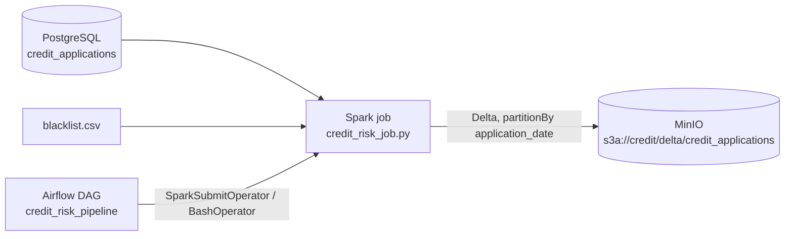
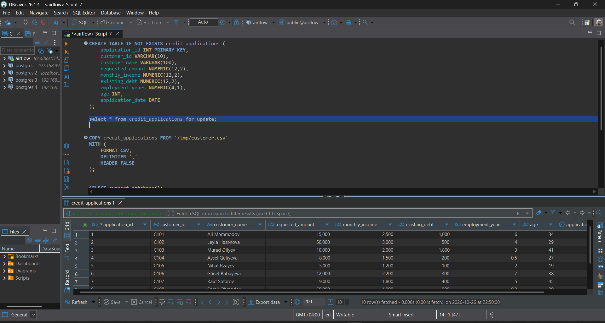
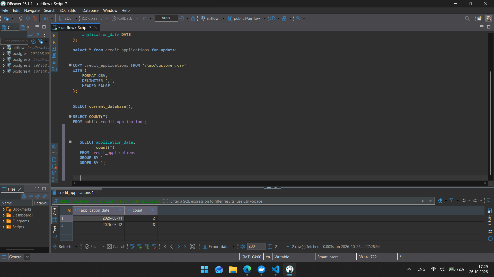
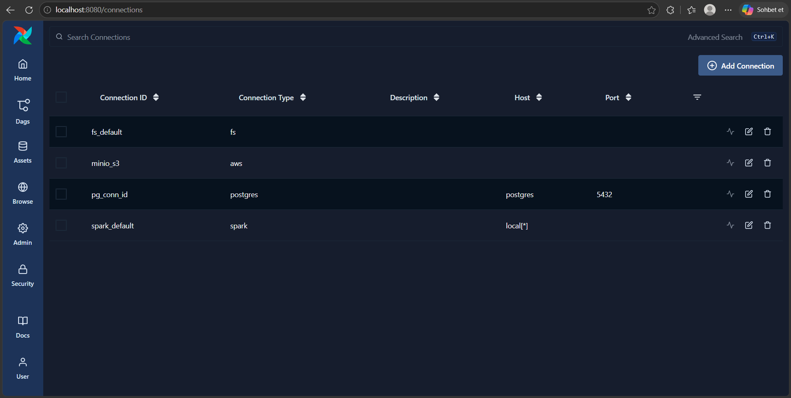
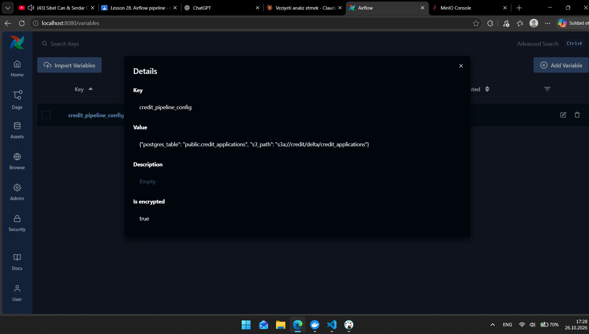
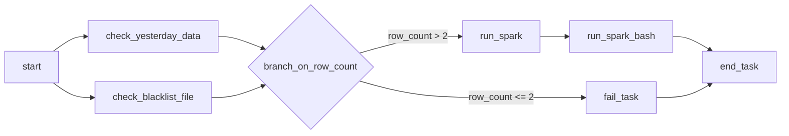
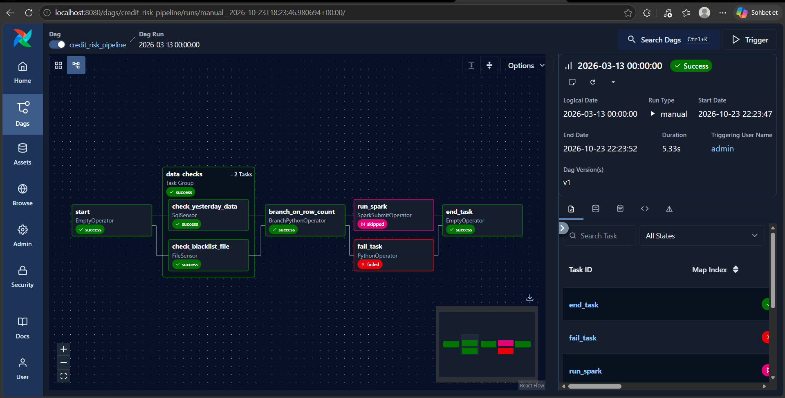
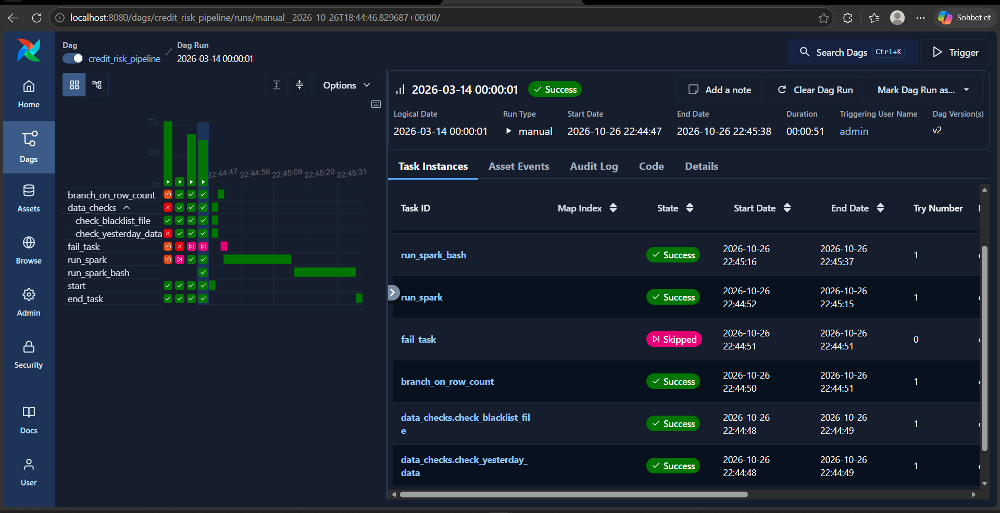
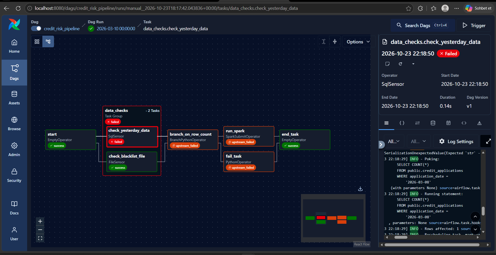
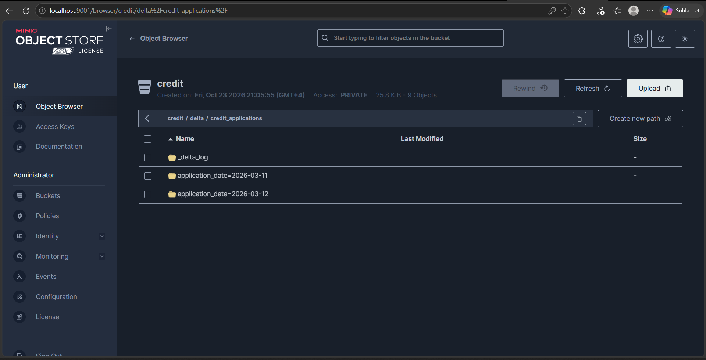

# credit_risk_pipeline

Kredit müraciətlərini risk statusuna görə təsnif edən end-to-end data pipeline. **Apache Airflow 3.1** pipeline-ı idarə edir, **PostgreSQL** mənbə datanı saxlayır, **PySpark** datanı `blacklist.csv` ilə birləşdirib `risk_status` hesablayır, nəticə **MinIO**-da (S3) **Delta Lake** formatında saxlanır. Hamısı Docker Compose ilə lokal qalxır.

## Mündəricat

1. [Ümumi baxış](#1-ümumi-baxış)
2. [Layihə strukturu](#2-layihə-strukturu)
3. [İnfrastruktur](#3-i̇nfrastruktur)
4. [Data](#4-data)
5. [Connection və Variable](#5-connection-və-variable)
6. [Spark job](#6-spark-job)
7. [DAG](#7-dag)
8. [Testlər və screenshot-lar](#8-testlər-və-screenshotlar)
9. [Bonus](#9-bonus)
10. [Necə işə salmaq olar](#10-necə-işə-salmaq-olar)
11. [Dizayn qərarları və qeydlər](#11-dizayn-qərarları-və-qeydlər)
12. [Tapşırıq tələbləri: harada nə var](#12-tapşırıq-tələbləri-harada-nə-var)

---

## 1. Ümumi baxış



**Risk qaydaları** (yuxarıdan aşağı, ilk uyğun qalır):

| Status | Şərt |
|---|---|
| `rejected` | müştəri blacklist-dədir |
| `high_risk` | `requested_amount > monthly_income * 12` **və ya** `existing_debt > monthly_income * 0.7` **və ya** `employment_years < 1` **və ya** `age < 21` |
| `approved` | qalan hamısı |

---

## 2. Layihə strukturu

```
.
├── docker-compose.yaml        # postgres, airflow (init/api-server/scheduler/dag-processor), minio
├── Dockerfile                 # apache/airflow:3.1.0 + Java 17 + requirements
├── requirements.txt           # Airflow provider-ləri, pyspark, delta-spark
├── .env                       # mühit dəyişənləri (repo-ya qoyulmur)
├── customer.csv               # başlanğıc data (Postgres konteyneri /tmp/customer.csv kimi görür)
├── sql/
│   ├── create_table.sql
│   └── insert.sql
├── airflow/
│   ├── dags/credit_risk_pipeline.py
│   ├── spark_jobs/credit_risk_job.py
│   ├── data/blacklist.csv
│   ├── files/  logs/  config/  plugins/
└── screenshots/
```

`airflow/` qovluğundakı alt qovluqlar konteynerlərə volume kimi qoşulur (`/opt/airflow/dags`, `/opt/airflow/spark_jobs`, `/opt/airflow/data` və s.).

---

## 3. İnfrastruktur

### Docker Compose servisləri

| Servis | Təsvir | Port (host) |
|---|---|---|
| `postgres` | `postgres:16`, həm Airflow metadata bazası, həm də `credit_applications` cədvəli. `customer.csv` konteynerə `/tmp/customer.csv` kimi qoşulur. | `5436 → 5432` |
| `airflow-init` | `db migrate` edir və `admin` istifadəçisini yaradır, sonra dayanır. | |
| `airflow-api-server` | Airflow UI və API. | `8080` |
| `airflow-scheduler` | Task-ları planlaşdırır (`LocalExecutor`). | |
| `airflow-dag-processor` | DAG fayllarını parse edir (Airflow 3-də ayrıca servisdir). | |
| `minio` | S3-uyğun obyekt saxlama, image `minio/minio:RELEASE.2025-04-22T22-12-26Z`. | `9000` (API), `9001` (Console) |

Airflow servisləri eyni `x-airflow-common` blokunu istifadə edir (build, env_file, volume-lar). Hamısı `lake` adlı bridge şəbəkəsindədir, ona görə konteynerlər bir-birini adla tapır (`postgres`, `minio`). `postgres` servisində healthcheck var və Airflow servisləri onun hazır olmasını gözləyir.

### Dockerfile

`apache/airflow:3.1.0` üzərində qurulur:
- `openjdk-17-jre-headless` quraşdırılır, çünki `spark-submit` Java tələb edir.
- `git`, `bash`, `curl`, `unzip` əlavə olunur.
- `requirements.txt` pip ilə quraşdırılır.

### requirements.txt

| Paket | Məqsəd |
|---|---|
| `apache-airflow-providers-standard` | `EmptyOperator`, `PythonOperator`, `BranchPythonOperator`, `BashOperator`, `FileSensor` |
| `apache-airflow-providers-common-sql` | `SqlSensor` |
| `apache-airflow-providers-postgres` | `PostgresHook`, Postgres Connection tipi |
| `apache-airflow-providers-fab` | Airflow 3-də FAB auth manager |
| `apache-airflow-providers-apache-spark==5.3.3` | `SparkSubmitOperator` |
| `pyspark==3.5.3` | Spark runtime (`spark-submit` buradan gəlir) |
| `delta-spark==3.3.2` | Delta Lake Python API |

### .env dəyişənləri

| Qrup | Dəyişənlər |
|---|---|
| Image | `AIRFLOW_IMAGE_NAME`, `AIRFLOW_PROJ_DIR`, `AIRFLOW_UID` |
| Airflow | `EXECUTOR=LocalExecutor`, `SQL_ALCHEMY_CONN`, `FERNET_KEY`, `AUTH_MANAGER` (FAB), `EXECUTION_API_SERVER_URL`, `API__SECRET_KEY`, `API_AUTH__JWT_SECRET`, `LOAD_EXAMPLES=false` |
| Postgres | `POSTGRES_USER`, `POSTGRES_PASSWORD`, `POSTGRES_DB` |
| MinIO | `MINIO_ROOT_USER`, `MINIO_ROOT_PASSWORD`, `MINIO_SERVER_URL`, `MINIO_BROWSER_REDIRECT_URL` |

Parollar yalnız `.env`-dədir və kodda yoxdur. Spark job MinIO məlumatlarını mühit dəyişənlərindən, Postgres login/parolunu isə DAG-ın ötürdüyü `PG_USER` / `PG_PASSWORD` dəyişənlərindən oxuyur.

---

## 4. Data

Bazanın adı `airflow`-dur, cədvəl `public.credit_applications`:

| Sütun | Tip |
|---|---|
| `application_id` | `INT PRIMARY KEY` |
| `customer_id` | `VARCHAR(10)` |
| `customer_name` | `VARCHAR(100)` |
| `requested_amount`, `monthly_income`, `existing_debt` | `NUMERIC(12,2)` |
| `employment_years` | `NUMERIC(4,1)` |
| `age` | `INT` |
| `application_date` | `DATE` |

SQL faylları: [`sql/create_table.sql`](sql/create_table.sql), [`sql/insert.sql`](sql/insert.sql). Cədvəl 10 sətirlə doldurulub:



Tarixlərə görə paylanma `2026-03-11` üçün 2, `2026-03-12` üçün 8 sətirdir. Bu rəqəmlər branch məntiqinin əsasını təşkil edir:



**`airflow/data/blacklist.csv`:**

```csv
customer_id,reason
C107,fraud
C108,default
C999,old_case
```

`C999` bazada yoxdur, ona görə heç bir müraciətlə uyğun gəlmir.

> `customer.csv` faylında vergüldən sonra boşluqlar var (`1, C101, ...`). `COPY` ilə yükləndikdə mətn sütunlarında əvvəldə boşluq qala bilər. Spark job join-dən əvvəl `customer_id` üzərində `upper(trim(...))` tətbiq etdiyi üçün bu, nəticəyə təsir etmir. `insert.sql` isə təmiz dəyərlərlə yazılıb.

---

## 5. Connection və Variable

| Connection ID | Tip | Parametrlər |
|---|---|---|
| `pg_conn_id` | Postgres | host `postgres`, port `5432`, schema `airflow`, login/parol `.env`-dən |
| `spark_default` | Spark | host `local[*]` |
| `fs_default` | File (path) | Extra `{"path": "/"}` |

(Screenshot-da həmçinin əvvəlki işlərdən qalan `minio_s3` Connection-ı görünür, bu pipeline onu istifadə etmir.)



**Variable `credit_pipeline_config`:**

```json
{"postgres_table": "public.credit_applications", "s3_path": "s3a://credit/delta/credit_applications"}
```



Cədvəl adı və S3 yolu DAG-da və Spark job-da sabit yazılmır, Variable-dan gəlir.

---

## 6. Spark job

Fayl: `airflow/spark_jobs/credit_risk_job.py`. Parametrlər: `--table` və `--s3-path` (DAG-dan gəlir).

**İş ardıcıllığı:**
1. `PG_USER`, `PG_PASSWORD`, `MINIO_ROOT_USER`, `MINIO_ROOT_PASSWORD` mühit dəyişənlərini oxuyur.
2. `SparkSession` yaradır, Delta extension və catalog-u aktivləşdirir.
3. Hadoop konfiqurasiyasında MinIO-nu qoşur: endpoint `http://minio:9000`, `path.style.access=true`, SSL söndürülüb.
4. `credit_applications`-u JDBC ilə oxuyur, `customer_id`-ni `upper(trim())` ilə təmizləyir.
5. `blacklist.csv`-ni oxuyur, `distinct()` edir və `is_blacklisted = true` sütunu əlavə edir.
6. **Left join** edir. `risk_status` sütununu `when / when / otherwise` ilə hesablayır (qaydalar 1-ci bölmədəki kimidir), köməkçi sütunu silir.
7. Hər statusun sayını `print` edir.
8. Say `{approved: 4, high_risk: 4, rejected: 2}` ilə uyğun gəlmirsə `ValueError` atır və Delta-ya yazılmır.
9. Nəticəni `delta` formatında, `application_date` üzrə `partitionBy` ilə, `overwrite` rejimində yazır.
10. `finally` blokunda `spark.stop()` çağırır.

**Gözlənilən nəticənin əl ilə yoxlanması:**

| Müştəri | Səbəb | Status |
|---|---|---|
| C101 | heç bir şərt ödənmir | approved |
| C102 | 50 000 > 3 000 × 12 | high_risk |
| C103 | borc 1 800 > 2 000 × 0.7 | high_risk |
| C104 | staj 0.5 < 1 | high_risk |
| C105 | yaş 19 < 21 | high_risk |
| C106 | heç bir şərt ödənmir | approved |
| C107 | blacklist | rejected |
| C108 | blacklist | rejected |
| C109 | heç bir şərt ödənmir | approved |
| C110 | heç bir şərt ödənmir | approved |

Real run-ın logunda da `approved 4`, `high_risk 4`, `rejected 2` və `DELTA WRITE SUCCESS: s3a://credit/delta/credit_applications` sətirləri çıxıb.

---

## 7. DAG

Fayl: `airflow/dags/credit_risk_pipeline.py`. `dag_id="credit_risk_pipeline"`, `schedule=None` (yalnız əl ilə trigger), `catchup=False`, `max_active_runs=1`, `retries=0`. Default argument-lərdə `on_failure_callback` təyin olunub.



| Task | Operator | Təsvir |
|---|---|---|
| `start` | `EmptyOperator` | Boş başlanğıc. |
| `check_yesterday_data` | `SqlSensor` | `pg_conn_id` ilə dünənki sətir sayına baxır. Cədvəl adı Variable-dan gəlir. `reschedule` modu, `poke_interval=10`, `timeout=60`. |
| `check_blacklist_file` | `FileSensor` | `fs_default` ilə `/opt/airflow/data/blacklist.csv` faylını yoxlayır. Eyni `reschedule`/`10`/`60` parametrləri. |
| `branch_on_row_count` | `BranchPythonOperator` | `PostgresHook` ilə dünənki sətirləri sayır. `> 2` olsa `run_spark`, əks halda `fail_task` qaytarır. |
| `fail_task` | `PythonOperator` | `AirflowFailException` ilə qəsdən xəta verir. |
| `run_spark` | `SparkSubmitOperator` | `spark_default` Connection ilə job-u işə salır. Delta, Postgres və hadoop-aws paketlərini `--packages` ilə yükləyir. Postgres login və parolunu `pg_conn_id`-dən `env_vars` ilə ötürür. |
| `run_spark_bash` | `BashOperator` | Bonus, aşağıda. |
| `end_task` | `EmptyOperator` | `trigger_rule="all_done"` ilə son task. |

### "Dünən" hesabı
`logical_date - 1 gün` hesabı **bir** funksiyada yazılıb (`get_yesterday`) və həm Jinja template-də (`SqlSensor`), həm də Python-da (`branch_on_row_count`) eyni funksiya istifadə olunur. Logical date UTC ilə saxlanır. UI-da GMT+4 ilə seçilən tarix UTC-də əvvəlki günə düşə bilər, məsələn UI-da `14.03.2026 00:00:01` yazmaq UTC-də `13.03.2026 20:00:01` verir və "dünən" `2026-03-12` çıxır.

### Failure callback
Task fail olanda `failure_callback` log-a qısa mesaj yazır: hansı DAG, hansı task, status `FAILED`.

### Niyə `end_task` üçün `all_done`?
Branch yalnız bir yolu işlədir, digər yol skip olur, `fail_task` isə qəsdən xəta verir. Default `all_success` qaydası ilə `end_task` bu hallarda işləməzdi. `all_done` isə qabaqkı tasklar uğurlu, uğursuz və ya skip olsa da `end_task`-ı işə salır. Yan təsir olaraq `fail_task` fail olsa belə, DAG run-ın özü `Success` görünür, çünki son task yaşıl bitir.

---

## 8. Testlər və screenshot-lar

### Test 1: Fail path
Logical date `2026-03-13`. UTC-də `2026-03-12 20:00`, dünən `2026-03-11`, orada 2 sətir var. `row_count > 2` ödənmir və branch `fail_task`-a gedir. `fail_task` fail olur, `run_spark` skip olur, `end_task` yenə işləyir. *(Bu run DAG-ın ilk versiyası ilə yaranıb, ona görə qrafda bonus task yoxdur.)*



### Test 2: Happy path
Logical date `2026-03-14 00:00:01`. UTC-də `2026-03-13 20:00:01`, dünən `2026-03-12`, orada 8 sətir var. Branch `run_spark`-a gedir, `fail_task` skip olur, hər iki Spark task-ı və `end_task` uğurla bitir.


Task-ların vaxtları ardıcıllığı təsdiqləyir: `run_spark` bitəndən sonra `run_spark_bash`, ondan sonra `end_task` işləyib.



### Əlavə müşahidə: sensor timeout
Dünən üçün data olmayan tarixlə trigger edəndə `check_yesterday_data` 60 saniyə sonra timeout verir, `branch_on_row_count`, `run_spark` və `fail_task` `upstream_failed` olur, `end_task` isə `all_done` sayəsində yenə işləyir.



### MinIO nəticəsi
`credit/delta/credit_applications/` içində `_delta_log/` və hər `application_date` üçün ayrıca partition qovluğu var.



---

## 9. Bonus

- **TaskGroup (+5):** iki sensor `data_checks` TaskGroup-una yığılıb. Task ID-lər `data_checks.check_yesterday_data` və `data_checks.check_blacklist_file` olur.
- **BashOperator ilə Spark (+5):** `run_spark_bash` eyni job-u `spark-submit` əmri ilə işə salır:
  - `--master` dəyəri `spark_default` Connection-ın host sahəsindən, tək dırnaq içində gəlir (`local[*]` shell glob olmasın deyə).
  - `--table` və `--s3-path` Variable-dan template ilə gəlir.
  - `PG_USER` / `PG_PASSWORD` komanda sətrində yox, `env=` ilə ötürülür, ona görə log-da görünmür.
  - `append_env=True` konteynerin digər mühit dəyişənlərini (`PATH`, MinIO açarları) saxlayır.
  - Task `run_spark`-dan sonra ardıcıl işləyir. Paralel işləsə, iki Spark eyni Delta yoluna yazar və eyni Ivy cache-i istifadə edərdi.

---

## 10. Necə işə salmaq olar

1. `.env` faylını yaradın (`_env` nümunəsindən) və dəyərləri doldurun.
2. Stack-i qaldırın:
   ```bash
   docker compose up -d --build
   ```
3. Airflow UI-a daxil olun: http://localhost:8080. MinIO Console: http://localhost:9001.
4. Postgres-ə qoşulun (host `localhost`, port `5436`, baza `airflow`) və `sql/create_table.sql`, sonra `sql/insert.sql` faylını işlədin.
5. `airflow/data/blacklist.csv` faylını yaradın.
6. MinIO-da `credit` bucket-ini yaradın.
7. Airflow-da 5-ci bölmədəki üç Connection-ı və `credit_pipeline_config` Variable-ını yaradın.
8. `credit_risk_pipeline` DAG-ını aktiv edib trigger edin. Happy path üçün logical date-i elə seçin ki, UTC-də dünən `2026-03-12` olsun.
9. İlk Spark run-ı Maven paketlərini yükləyir və bir neçə dəqiqə çəkə bilər.

---

## 11. Dizayn qərarları və qeydlər

- **Baza və bucket adları:** tapşırıqda `credit_db` və `credit-bucket` yazılıb, bu layihədə isə `airflow` bazası və `credit` bucket-i istifadə olunub. Bütün konfiqurasiya buna uyğundur.
- **Parol təhlükəsizliyi:** parollar yalnız `.env`-dədir. Postgres məlumatları Connection-dan `env_vars` ilə Spark-a ötürülür.
- **Variable-dan oxuma:** `SparkSubmitOperator` üçün Variable DAG faylının yuxarısında `Variable.get(...)` ilə oxunur, `run_spark_bash` üçün isə template (`var.json...`) ilə. Template üsulu hər DAG parse-da bazaya getməməsi baxımından daha yaxşıdır.
- **Sərt yazılmış dəyərlər:** Spark job-da JDBC URL (`jdbc:postgresql://postgres:5432/airflow`) və MinIO endpoint-i (`http://minio:9000`) kodda yazılıb. Başqa mühitdə bunlar parametrə çevrilə bilər.
- **Overwrite:** happy path-də iki Spark task-ı eyni yola `overwrite` ilə yazır. Data eyni olduğu üçün nəticə dəyişmir, Delta isə yeni versiya yaradır.
- **Deprecation xəbərdarlıqları:** `airflow.utils.task_group.TaskGroup` əvəzinə `airflow.sdk.TaskGroup`, `airflow.utils.trigger_rule.TriggerRule` əvəzinə `airflow.task.trigger_rule.TriggerRule` istifadə etmək olar.
- **Log-dakı zərərsiz xəbərdarlıqlar:** `ps: command not found` (Spark start skripti), `MetricsConfig`, `Truncated the string representation`.

---

## 12. Tapşırıq tələbləri: harada nə var

| Tələb | Harada |
|---|---|
| Data, Connection, Variable | 4 və 5-ci bölmələr |
| Spark job | 6-cı bölmə |
| Sensorlar (reschedule, 10 san, 60 san) | 7-ci bölmə, `check_yesterday_data` və `check_blacklist_file` |
| Branch, `fail_task`, callback | 7-ci bölmə |
| `run_spark` | 7-ci bölmə |
| `end_task` və `all_done` izahı | 7-ci bölmə, axırıncı başlıq |
| Graph və MinIO screenshot-ları | 8-ci bölmə |
| Bonus (TaskGroup, BashOperator) | 9-cu bölmə |
